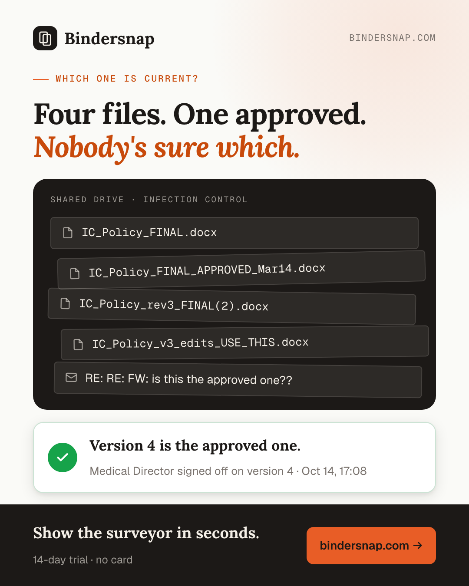
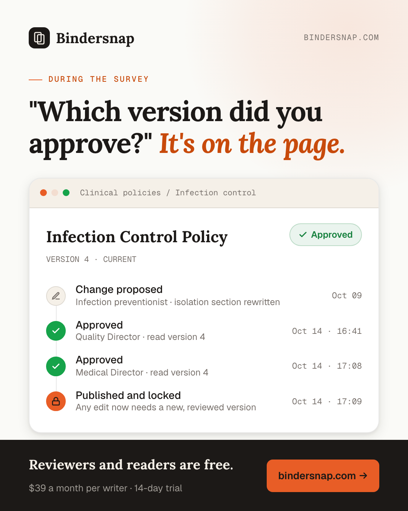
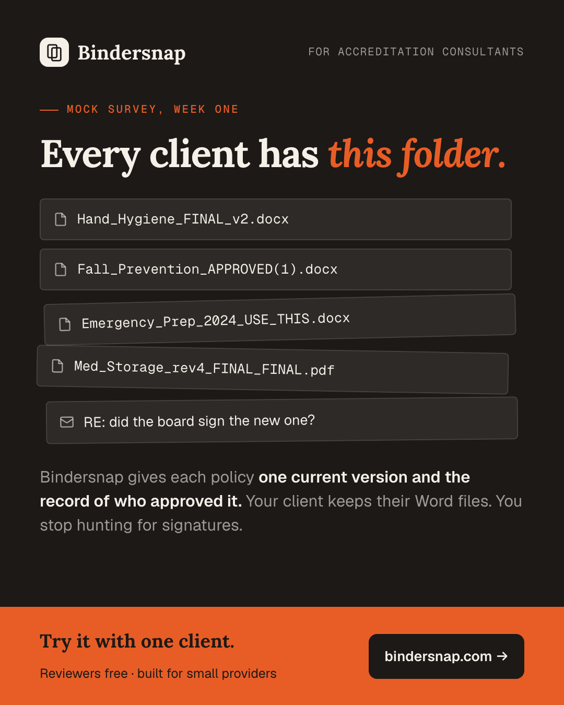

# Bindersnap — LinkedIn posts

Four posts for the first customers, with the images beside them. The images
are drawn from `cards.html` in the site's tokens and fonts; after editing it,
run `bun docs/gtm/linkedin/render.ts`.

Post one a week, Tuesday to Thursday morning. Put the link in the first
comment, not the post. Answer every comment within the first hour.

---

## Week 1 — The filename

**Image:** `linkedin-1-filename.png`

Four files. One of them is the approved policy. Nobody's sure which.

IC_Policy_FINAL.docx
IC_Policy_FINAL_APPROVED_Mar14.docx
IC_Policy_rev3_FINAL(2).docx

Then a surveyor asks which version your medical director signed off on, and you start digging through email.

If you run compliance or operations at a small clinic, surgery center, home health agency or hospice, you've probably been there. Big health systems buy policy software that costs more than your whole budget. Everyone else gets Word, email and a shared drive.

So I built Bindersnap.

Every policy keeps one current approved version and a record of who approved it, when, and which version they read. An approved version can't quietly change. An edit becomes a new version and goes through review again.

→ Keep writing in Word. Upload the file and Bindersnap handles the review and approval.
→ Reviewers and readers are free. Writers are $39 a month each.
→ 14-day trial, no card.

I'm looking for the first few small providers to try it on their real policy binders. I'll help you set it up myself.

If "which version did we approve?" has ever cost you an afternoon, send me a message. Or tag the compliance lead who lives in that shared drive.

#healthcarecompliance #policymanagement #ambulatorysurgery #homehealth #hospice

**First comment:** Try it free for 14 days, no card: https://bindersnap.com

---

## Week 2 — During the survey

**Image:** `linkedin-2-surveyor.png`

"Which version of this policy did you approve, and who approved it?"

A surveyor can ask that about any policy in your manual, and asking takes ten seconds. Answering it from a shared drive can take most of an afternoon.

Here's the same question in Bindersnap:

1. Open the policy.
2. The current version is at the top, marked Approved.
3. Below it is every step: who proposed the change, who approved it, which version each person read, and the minute it was published.

That's it. The record isn't a report somebody puts together the night before. It's written down as the approvals happen, and nobody can edit it afterward. If someone changes an approved policy, that's a new version, and it goes back through review.

Who approves is up to you. Name your approvers, set how many sign-offs a policy needs, and Bindersnap won't publish it until it has them.

Your approvers don't need a paid seat. Reviewers and readers are free. You pay only for the people who write policies, $39 a month each.

If you have a survey coming up in the next year, start now, while there's time to put your manual in order.

#accreditation #surveyreadiness #healthcarecompliance #qualityimprovement

**First comment:** 14-day trial, no card: https://bindersnap.com

---

## Week 3 — Why I built it

**Image:** none. A plain-text founder story usually gets more reach and replies than one with a graphic.

My wife came home frustrated with her policy system often enough that I started asking questions.

Part of her job is keeping policies current: rewriting them, getting them reviewed, getting the right people to sign off.

The questions were always the same.
Which version is current?
Did the medical director approve this one or the one before it?
Where's the email where she said yes?

I write software for a living. Every software team takes one thing for granted: a permanent record of who approved which change, and when. Nobody on the team argues about which version shipped, because the record says.

Healthcare has the opposite situation. The stakes are higher, a surveyor can ask to see the record, and the record is a folder of files named FINAL.

So I built Bindersnap for her, and for every small provider in the same spot: clinics, surgery centers, home health, hospice, behavioral health and rural health clinics.

Each policy keeps one current approved version, and its own record of who approved it, when, and which version they read.

It's live now. I'm looking for the first providers to use it, and I'll set it up with you myself. If you manage policies at a small provider, I'd like to hear how you do it today, even if you never buy anything. Send me a message.

#healthcare #nursingleadership #compliance #founder

**First comment:** If you want to see it: https://bindersnap.com

---

## Week 4 — For accreditation consultants

**Image:** `linkedin-3-consultants.png`

Accreditation consultants: you know this folder.

Hand_Hygiene_FINAL_v2.docx
Fall_Prevention_APPROVED(1).docx
RE: did the board sign the new one?

On a lot of engagements, the first week of mock-survey prep goes to finding out which policies are current and who signed them, before you can even look at what they say.

I built Bindersnap to fix that part. Each of your client's policies gets one current version and a record of who approved it and when. Your client keeps writing in Word. You see what's approved, what's waiting on whom, and what changed since your last visit.

Your client's reviewers and readers are free, so you can be added to their account at no cost.

I'd like to try it with one of your clients. Pick a small provider with a survey on the calendar, and I'll set it up with you and them myself.

If that sounds useful, send me a message. If you know a consultant who spends their first week digging through shared drives, tag them.

#accreditation #healthcareconsulting #surveyreadiness #ambulatorysurgery #homehealth

**First comment:** https://bindersnap.com — 14-day trial, no card
